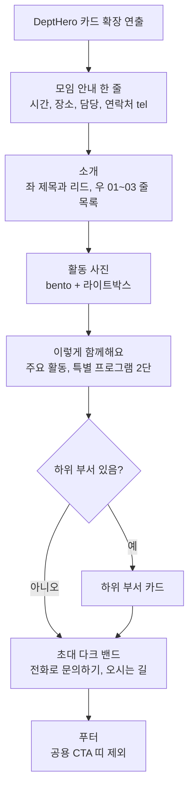

<!-- projectops:report -->
## 개요

사역 부서 상세 페이지(`/departments/{slug}`)를 "안내서형"으로 다시 짰습니다. 5개 부서가 같은 흐름을 씁니다. 처음 오는 분이 찾는 모임 정보를 맨 앞으로 올리고, 반복되던 카드 묶음과 겹치던 소개글을 정리했습니다.

## 기능 흐름

## 변경 사항

| 파일 | 내용 |
|---|---|
| `src/app/departments/[slug]/page.tsx` | 섹션 순서 재구성, description 블록과 공용 `CtaBand` 제거, "이렇게 함께해요" 섹션 합성 |
| `src/components/departments/DeptInfo.tsx` | 카드 4장 → 히어로 아래 4칸 한 줄, 아이콘, 연락처 `tel:` 링크 |
| `src/components/departments/DeptFeatures.tsx` | 3색 카드 → 4:8 번호 줄 목록, 아이콘 매핑 확장 |
| `src/components/departments/DeptGallery.tsx` | 균등 그리드 → bento 배치 |
| `src/components/departments/DeptActivities.tsx`, `DeptPrograms.tsx` | 독립 섹션 → 한 섹션의 2단 칸(줄 목록) |
| `src/components/departments/DeptInvite.tsx` | primary-soft 띠 → 다크 밴드 + CTA 2개 |
| `src/constants/departments.ts` | 모임 안내 순서 변경, `DeptInfoItem.icon` 추가, 부서별 항목 아이콘 교체, 라벨 상수 추가 |
| `.claude/rules/DESIGN.md` | `dept-detail` 흐름과 섹션 규칙 등록 |
| 테스트 5개 파일 | 새 구조 기준으로 갱신 |

## 수정 전후 화면

| 수정 전 | 수정 후 (데스크톱) | 수정 후 (모바일) |
|---|---|---|
|  |  |  |

수정 후 화면은 로컬 dev 서버 `/departments/student` 실제 렌더 캡처입니다(히어로 아래 구간). 데스크톱 캡처의 초대 밴드 위 헤더는 고정 네비가 전체 페이지 캡처에 함께 찍힌 것입니다.

## 주요 구현 내용

- 아이콘은 상수에 직렬화 키(`clock`, `pin`, `mic` 등)로 두고 컴포넌트에서 lucide로 매핑합니다(기존 방식 유지).
- 연락처는 `icon: "phone"`인 항목만 `tel:` 링크가 되고, 같은 번호를 초대 밴드의 전화 버튼에도 씁니다. 번호가 없는 부서는 "오시는 길" 버튼만 나옵니다.
- 사진 배치는 4장 기준(첫 장 2×2, 넷째 장 가로 2칸)이며 5장째부터는 일반 칸으로 이어집니다.
- 검증: 부서 관련 테스트 전부 통과, `tsc`, `pnpm build` 통과. 전체 테스트의 기존 실패 99건(auth, about 등)은 main과 같은 수로 이번 변경과 무관합니다.

## 주의사항

- `description`(마크다운)은 상세에서 더 이상 노출되지 않습니다. 데이터는 남겨 두었으며 정리 여부는 별도 결정이 필요합니다.
- 부서별 소개 헤드라인 문구는 넣지 않았습니다(콘텐츠 확정 필요). 현재 소개 제목은 "학생부 소개" 형태입니다.
- 히어로(DeptHero)는 변경하지 않았습니다.
