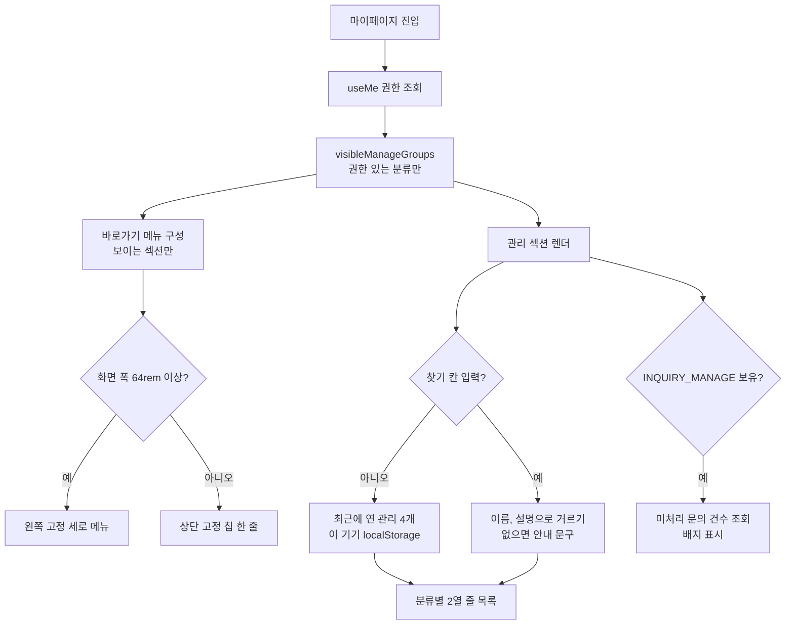

<!-- projectops:report -->
## 개요

마이페이지(`/mypage`)를 "왼쪽 고정 메뉴 + 관리 찾기" 구성으로 바꿨습니다. 관리자가 관리 메뉴 14개 가운데 원하는 곳을 이름을 하나씩 읽지 않고 바로 찾을 수 있게 했습니다. 시안 비교(A·B·C, C 변형 3종)에서 고른 C3안을 구현했습니다.

## 기능 흐름

## 변경 사항

| 파일 | 내용 |
|---|---|
| `src/lib/admin/manageDomains.ts` | 관리 메뉴마다 `desc`(설명 한 줄)·`Icon` 추가, 분류에 `Icon` 추가, 권한별 분류를 계산하는 `visibleManageGroups()` 추가 |
| `src/components/mypage/MypageNav.tsx` | 새 파일. 데스크톱 왼쪽 고정 메뉴와 폰 상단 칩, 스크롤 위치에 따른 현재 항목 표시 |
| `src/components/mypage/ManageHub.tsx` | 카드 그리드 → 찾기 칸 + 최근에 연 관리 + 분류별 2열 줄 목록, 미처리 문의 건수 배지 |
| `src/components/mypage/MypageContent.tsx` | 42rem 한 컬럼 → 1200px 컨테이너 안 12열(메뉴 3 : 본문 9), 내 정보 → 내 활동 → 관리 → 계정 섹션 |
| `src/components/mypage/ProfileCard.tsx` | 이용 권한 배지 목록 제거 |
| `.claude/rules/DESIGN.md` | `mypage-layout`·`mypage-nav` 추가, `manage-hub` 개편 내용으로 교체 |
| `src/app/globals.css` | `--container-narrow` 주석에서 마이페이지 언급 제거(마이페이지는 더 이상 이 폭을 쓰지 않음) |
| 테스트 3개 파일 | 찾기, 최근 목록, 깨진 저장값, 미처리 건수, 메뉴 구성 테스트 추가, 권한 배지 테스트 갱신 |

## 수정 전후 화면

| 수정 전 | 수정 후 (데스크톱) | 수정 후 (모바일) |
|---|---|---|
|  |  |  |

- 화면은 실제 앱(개발 서버)을 띄워 찍었습니다. 로그인 계정 대신 브라우저에서 API 응답을 관리자 권한 17개를 가진 가짜 데이터로 바꿔 넣었고, 미처리 문의는 3건으로 가정했습니다.
- 수정 후 데스크톱: 메뉴 "관리 찾기" → 찾기 칸에 "주보" 입력 → 메뉴 "콘텐츠", "회원·권한", "계정" 순서로 누름
- 수정 후 모바일: 상단 칩으로 같은 순서 이동

## 주요 구현 내용

- **메뉴와 본문이 같은 함수를 쓴다**: 권한별로 보이는 분류는 `visibleManageGroups()` 하나에서만 계산합니다. 메뉴와 관리 섹션이 각자 계산하면, 메뉴에는 있는데 본문에는 없는 분류(누르면 아무 데도 안 가는 링크)가 생길 수 있어서입니다. 내 활동도 같은 이유로, 자식 컴포넌트가 쓰는 쿼리를 부모에서 한 번 더 불러 "보일 내용이 있을 때만" 메뉴에 싣습니다. 같은 쿼리키라 요청은 한 번만 나갑니다.
- **현재 위치 표시**: 화면 높이 30~40% 띠를 지나는 섹션을 현재 항목으로 표시합니다(IntersectionObserver). 띠를 좁게 잡아 한 번에 한 섹션만 걸리게 했습니다. 폰 칩은 현재 칩이 가로 스크롤 밖으로 나가면 가운데로 끌어오되, `scrollIntoView` 대신 칩 줄의 `scrollLeft`만 바꿔 페이지 세로 스크롤은 건드리지 않습니다.
- **최근에 연 관리**: 관리 링크를 누를 때 이 기기의 브라우저 저장소에 최대 4개를 기록합니다. 서버 API가 없어도 되고, 권한이 빠진 메뉴는 기록에 남아 있어도 보이지 않습니다. 저장소가 막혔거나 값이 깨져 있으면 최근 목록 없이 동작합니다.
- **미처리 문의 건수**: `GET /api/admin/inquiries?completed=false&size=1`의 `totalElements`를 씁니다. 문의 관리 화면이 쓰는 쿼리키 규약(`adminKeys.list("inquiries", …)`)을 그대로 따라서, 문의를 완료 처리하면 기존 무효화 코드로 건수도 함께 갱신됩니다. `INQUIRY_MANAGE`가 없으면 아예 조회하지 않습니다.
- **회원·권한 구분**: 회원·권한 메뉴만 아이콘 바탕을 회색으로 둬 다른 메뉴와 거리를 뒀습니다. 실수하면 피해가 큰 메뉴라서입니다.

## 주의사항

- **로컬 테스트 실행 옵션**: 이 컴퓨터의 Node 26에서는 `localStorage`를 쓰는 테스트가 그냥 실행하면 실패합니다(`main`에서도 같음). Node 내장 `localStorage`가 jsdom 것을 가리기 때문입니다. `NODE_OPTIONS=--no-experimental-webstorage pnpm test`로 돌리면 통과합니다.
  - 마이페이지 테스트 49개 통과
  - 전체 1126개 중 실패 2개(`SymbolismList`·`VisionHero`)는 `main`에서도 똑같이 실패하는 기존 문제입니다.
- **내 활동 카드는 그대로입니다**: 통독 이력과 차량 탑승은 기존 카드를 "내 활동" 섹션 안에 2열로 묶기만 했습니다. 시안의 진도바 타일로 바꾸는 건 별도 작업입니다.
- **설명 문구 검토 필요**: 관리 메뉴의 설명 한 줄은 새로 쓴 문구입니다. 교회 실정에 맞게 `manageDomains.ts`에서 고치면 됩니다.
- **섹션 id를 바꿀 때**: 메뉴 링크(`#mypage-profile`, `#mypage-manage-content` 등)는 섹션 id를 직접 가리킵니다. id를 바꾸면 메뉴가 엉뚱한 곳으로 가거나 현재 항목 표시가 멈춥니다. `MypageContent.test.tsx`가 메뉴가 가리키는 섹션이 실제로 있는지 확인합니다.
- **실제 백엔드 데이터로는 아직 확인하지 않았습니다**: 화면 확인은 가짜 API 응답으로만 했습니다. 실제 관리자 계정으로 한 번 들어가 미처리 문의 건수가 맞게 나오는지 확인이 필요합니다.
