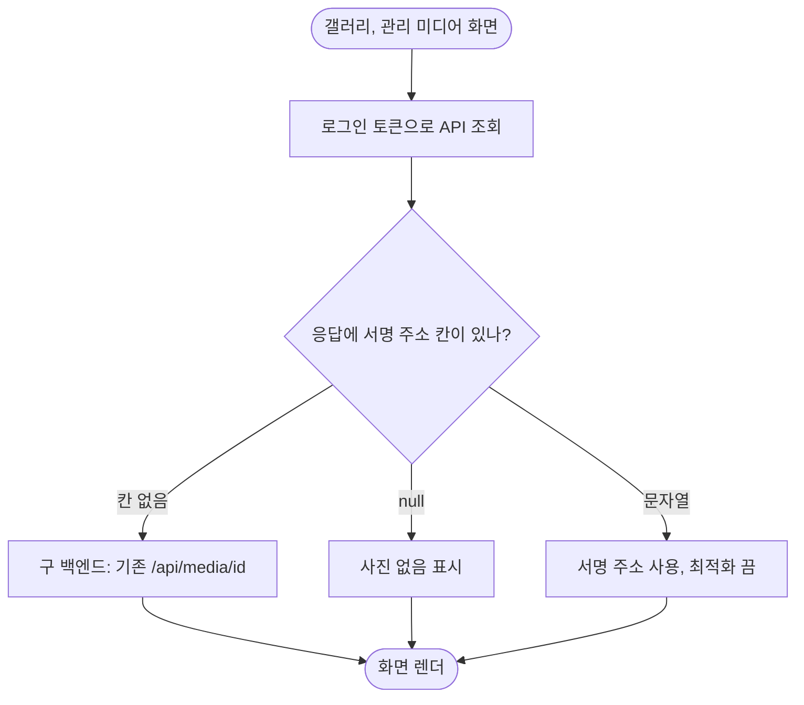

<!-- projectops:report -->
# 부서 사진, 소개 직접 수정

## 개요

백엔드 #92가 미디어 공개 범위를 바꾼다. 지금은 `/api/media/{id}`가 누구에게나 열려 있어 번호를 차례로 넣으면 교인 전용 갤러리 사진을 모두 받을 수 있는데, 바뀐 뒤에는 교인 전용 사진이 서명 주소(1시간 유효)로만 열린다. 이 프론트가 서명 주소를 쓰도록 바꿨다(필수). 같은 구조로 부서 사진과 소개를 관리 화면에서 바꾸는 기능도 넣었다(선택). 은샘 서버에는 아직 부서가 없어서 이 기능은 꺼진 상태와 같고 화면은 지금과 똑같다. PR #182로 `main`에 병합했다.

## 흐름

## 변경 사항

### 미디어 공개 범위 대응 (필수)
- `src/lib/mediaUrl.ts`(신규): `mediaSrc(id, signedPath?)` 한 곳에서 서명 주소와 기존 주소 선택
- `src/lib/markdown.ts`, `src/components/common/MarkdownContent.tsx`: 앨범 설명의 `media:{id}`를 `mediaUrls`로 치환, 키가 없는 이미지는 그리지 않음
- `src/components/gallery/AlbumCard.tsx`, `PhotoGrid.tsx`, `PhotoLightbox.tsx`, `AlbumDetail.tsx`, `AlbumForm.tsx`: 서명 주소 우선
- `src/components/admin/media/MediaLibrary.tsx`, `src/components/admin/MediaPicker.tsx`: 썸네일과 "열기"를 `url`로
- `src/components/admin/MarkdownEditor.tsx`, `MarkdownToolbar.tsx`: 저장 전 방금 고른 사진은 서명 주소로 미리보기
- `docs/api-docs.json`: 백엔드 PR #93 코드에서 뽑은 최종 계약으로 갱신

### 부서 사진·소개 (선택)
- `src/constants/departments.ts`: 백엔드 부서 id 칸(`backendId`) 추가, 모두 비워 둠
- `src/lib/api/departments.ts`, `types.ts`: `heroMediaId`, `albumId`, `photos`(mediaId 숫자 배열) 반영, 값이 없으면 상수로 대체
- `src/app/departments/page.tsx`, `[slug]/page.tsx`, `src/components/departments/DeptFeatures.tsx`: 대표 사진·활동 사진·소개 본문 API 우선
- `src/components/departments/DeptEditAction.tsx`(신규): `DEPT_WRITE` 권한자용 "수정" 버튼
- `src/components/admin/departments/DepartmentFormDialog.tsx`, `schema.ts`: 대표 사진·앨범 고르기, 공개 범위 안내 문구, PUT에 두 칸 항상 포함, 저장 시 캐시 비우기
- `src/components/gallery/GalleryPhotoManager.tsx`: "사진 추가" 아래 공개 안내 문구

### 테스트 정리
- `src/components/about/VisionHero.test.tsx`: 로고 대체 글을 하드코딩한 "은샘침례교회 로고" 대신 `CHURCH_LOGO.alt` 상수로 비교
- `src/components/about/SymbolismList.test.tsx`: 색 이름이 별도 ``이 된 제목 마크업에 맞춰 `h3` 전체 글자로 비교

## 주요 구현 내용

- **"칸 없음"과 `null`을 구분한다.** 서명 주소 칸이 아예 없으면 구 백엔드로 보고 기존 주소를 만든다. `null`이면 사진이 없는 것이라 주소를 만들지 않는다. 차단이 켜진 뒤 기존 주소를 만들면 404로 깨지기 때문이다. 이 구분 덕분에 백엔드와 프론트의 배포 순서가 어긋나도 화면이 깨지지 않는다.
- **서명 주소는 `next/image` 최적화를 끈다.** `remotePatterns`가 쿼리스트링 있는 주소를 거절하고, 최적화 캐시(31일)가 만료된 사진을 계속 내줄 수 있어서다. 서명 없는 공개 주소는 지금처럼 최적화한다.
- **서명 주소가 서버 캐시에 들어가지 않는다.** 갤러리와 관리 미디어는 모두 로그인한 브라우저가 직접 불러오고, 서버 페이지는 껍데기만 그린다.
- **소개 본문은 화면에 실제로 보이는 자리에만 넣었다.** 상세 페이지는 상수 `description` 블록을 그리지 않고 소개 섹션의 짧은 소개글을 보여 주므로, API `description`은 그 자리를 대신한다.
- 실패하던 소개 페이지 테스트 2개는 원인이 서로 달랐다. `VisionHero`는 교회 이름(약칭 "은샘교회")을 따라가지 못한 것이고, `SymbolismList`는 제목 마크업 변경을 따라가지 못한 것이다. 화면은 정상이라 테스트만 고쳤다.

## 주의사항

- **배포 순서**: 백엔드 #93 배포(차단 꺼짐) → 이 프론트 배포(`main → deploy`) → church-backend#92에 알려 차단 켜기. 이 프론트가 배포되기 전에 차단을 켜면 갤러리와 관리 미디어 사진이 깨진다.
- **배포 후 확인**: 로그인 상태에서 갤러리·관리 미디어·편집 미리보기 요청 주소에 `exp`·`sig`가 붙는지, 로그아웃 상태에서 공지·행사·부서·주보 사진이 보이는지. 차단이 꺼져 있으면 빠뜨려도 화면이 안 깨지니 주소를 직접 본다.
- **부서 사진 기능을 쓰려면**: 관리 화면에서 부서를 등록한 뒤 `src/constants/departments.ts`의 `backendId`를 채운다. 그 전에는 지금 화면 그대로다.
- **역할**: 부서 담당 역할에 `DEPT_WRITE`, `GALLERY_WRITE`, `MEDIA_MANAGE`와 앨범 목록 조회용 `GALLERY_VIEW`를 함께 넣는다.
- **갤러리 안내 문구는 모든 앨범에 뜬다.** 백엔드 응답에 "이 앨범은 부서에 연결돼 공개 중" 표시가 없어서 연결된 앨범에만 띄울 수 없다. 백엔드에 표시가 생기면 조건부로 바꾼다.
- 앨범 고르기는 최신 100개까지만 불러온다. 앨범이 더 많아지면 검색형으로 바꿔야 한다.
