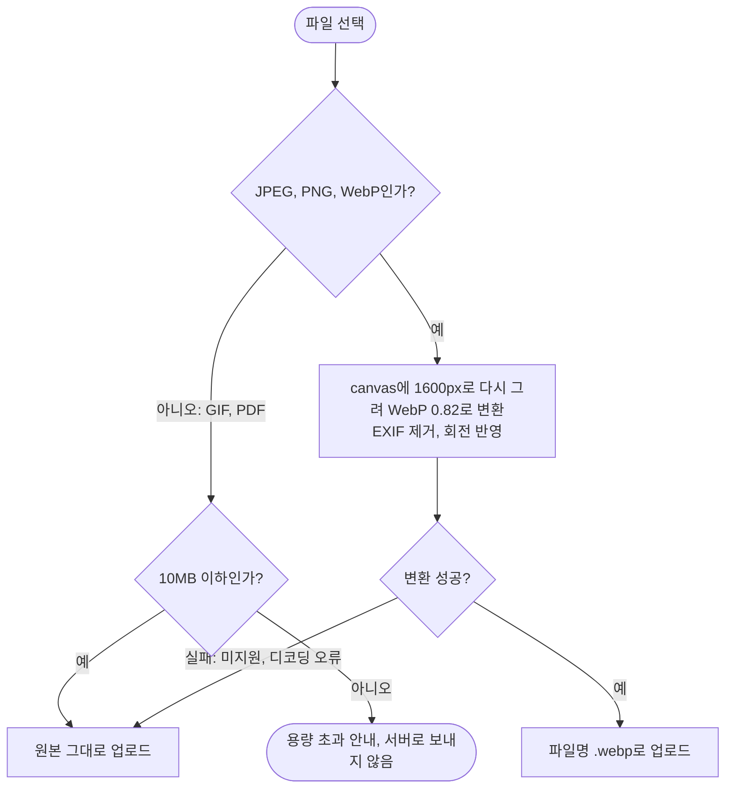

<!-- projectops:report -->
# 사진 업로드 전 WebP 변환

## 개요

관리자 사진 업로드가 휴대폰 원본(수 MB, EXIF에 촬영 위치 GPS 포함)을 그대로 서버에 올리고 있었다. 부서 대표 사진과 부서에 연결한 앨범 사진은 누구나 받을 수 있는 공개 미디어(church-backend #92)라, 원본을 올리면 촬영 위치가 노출된다. 서버(OCI 1GB)에서 변환하지 않고 브라우저에서 줄여 보내도록, 새누리 프론트에서 운영 중인 구현을 그대로 가져왔다. [PR #189](https://github.com/church-template/eunsaem-frontend/pull/189)로 `main`에 병합했고 아직 배포하지 않았다.

## 흐름

## 변경 사항

- `src/lib/imageToWebp.ts`, `imageToWebp.test.ts`(신규): 새누리 파일 그대로. 긴 변 1600px로 축소(작은 사진은 그대로), 품질 0.82 WebP, 확장자 `.webp`, canvas에 다시 그려 EXIF 제거, `createImageBitmap`으로 EXIF 회전 반영.
- `src/components/admin/MediaUploader.tsx`: 새누리와 다른 두 곳만 바꿨다.
  - 변환하는 사진은 10MB 원본 용량 검사에서 뺀다. 줄어서 올라가기 때문이다. PDF·GIF는 지금처럼 10MB 검사.
  - 사진을 한 장씩 변환한 뒤 올린다(큰 사진 여러 장을 한꺼번에 디코딩하지 않게).
- `src/components/admin/MediaUploader.test.tsx`: 새누리의 10MB 테스트에 두 가지를 더했다. JPEG는 `.webp`로, GIF·PDF는 원본 그대로 올라가는지, 10MB 넘는 PDF가 막히는지.

## 주요 구현 내용

- **변환이 실패해도 업로드를 막지 않는다.** 브라우저가 WebP 인코딩을 못 하거나 디코딩에 실패하면 원본을 올린다. 이때 원본이 10MB를 넘으면 서버가 `FILE_SIZE_EXCEEDED`로 거절한다.
- GIF는 변환하면 움직임이 사라지므로 원본을 올린다.
- **로컬 업로드 확인:** 로컬에 백엔드와 DB를 띄워 미디어 관리 화면에서 직접 올렸다. 시험 사진은 42MB 세로 JPEG이며, 가로로 저장하고 EXIF 회전값으로 세로로 보이게 했고 GPS를 넣었다. 사진이 눕는지 보려고 저장 기준 왼쪽에 빨간 띠를 넣었다.
  - 저장된 파일: `portrait-gps.webp`, `image/webp`, 688KB(원본 42MB)
  - 크기 1200×1600 세로, 빨간 띠가 위쪽 → 사진이 눕지 않음
  - 저장된 파일의 EXIF 0개 → GPS 제거됨
  - GIF·PDF는 이름·형식이 원본 그대로이고 바이트까지 같음
  - 10MB 넘는 PDF는 "파일 용량이 10MB를 초과했습니다." 안내가 뜨고 서버로 보내지 않음
- 테스트 1187개, 타입 검사, 린트(오류 0), 빌드 통과.

## 주의사항

- **이미 올라간 사진은 변환하지 않는다.** 이 배포 이후에 올리는 사진부터 적용된다.
- **새 사진은 이 배포가 나간 뒤에 올린다.** 배포 전에 올리면 원본 위치정보가 공개 사진에 남는다.
- 백엔드는 고치지 않았다. 변환은 브라우저에서만 한다.
- 진짜 휴대폰 사진으로 한 번 확인하면 좋다(위 확인은 시험용 사진으로 했다).
