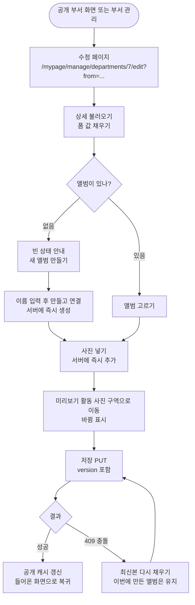

<!-- projectops:report -->
# 🚀[기능개선][관리] 수정 화면을 페이지와 미리보기로 통일, 앨범 바로 만들기

## 개요

관리 수정 화면의 공통 틀(왼쪽 입력, 오른쪽 미리보기, 아래 고정 저장 막대)을 만들고, 부서 등록·수정을 32rem 모달에서 이 틀의 전용 페이지로 옮겼습니다. 부서의 활동 사진 앨범은 갤러리로 떠나지 않고 그 자리에서 만들어 연결하고 사진을 넣을 수 있게 했습니다. 이 이슈의 계획 1(공통 틀 + 부서)이며, 설교·공지·일정·주보·앨범·챌린지 폼 전환은 계획 2로 남아 있어 이슈는 열어 둡니다. (PR #192)

## 수정 전후

| 수정 전 (`60f522e`, 모달) | 수정 후 (`main`, 페이지 + 미리보기) |
|---|---|
|  |  |

| 폰: 입력 | 폰: 미리보기 시트 |
|---|---|
|  |  |

- 공개 학생부 화면에서 `수정`을 눌러 들어가는 같은 경로로 찍었습니다. 수정 전은 PR 직전 커밋(`60f522e`)을 별도 작업 트리에 띄워 찍었습니다
- 운영 서버를 건드리지 않도록 브라우저 안에서만 가짜 백엔드 응답을 붙였습니다(앨범·사진은 가짜 데이터, 사진은 저장소의 부서 사진)

## 기능 흐름

## 변경 사항

### 공통 틀 (`src/components/admin/editor/`)
- `EditPageShell.tsx`: 머리(돌아가기 + 제목), 입력 7 : 미리보기 5 그리드, 아래 고정 저장 막대(상태 문구 · 취소 · 저장), 64rem 미만은 `미리보기` 버튼으로 아래 시트
- `useFitAbove.ts`: 미리보기 칸 높이를 "칸 윗변 ~ 저장 막대 윗변"으로 맞춤(스크롤·창 크기·레이아웃 변화 감지, 간격은 `spacing.base` 토큰)
- `Field.tsx`·`FormSection.tsx`·`ChangedBadge.tsx`: 칸(필수/선택 표기, 설명은 입력칸 아래), 구역 제목, `바뀜` 배지
- `src/components/ui/sheet.tsx`, `globals.css`: 아래에서 올라오는 시트(`side="bottom"`)와 애니메이션
- `src/components/ui/Input.tsx`·`Textarea.tsx`: 기본 테두리 `hairline` → `muted-soft`(전역), `aria-describedby`를 호출한 쪽 설명 id와 오류 id를 합쳐 걸도록

### 부서 수정 (`src/components/admin/departments/`)
- `DepartmentEditForm.tsx`, `departmentForm.ts`: 옛 수정 창의 저장 규칙(상세 시드 · 낙관락 version · 409 재조회 · 사진 칸 명시)을 페이지 폼으로 옮김. 구역은 기본 정보 / 사진 / 소개 글 / 목록에서의 자리
- `DeptAlbumField.tsx`: 빈 상태 안내, 새 앨범 만들기 창, 연결 카드(썸네일 · 장수 · 사진 넣기 · 앨범 열기), 공개 안내. 만들기·사진 넣기는 `GALLERY_WRITE`가 있을 때만
- `DeptEditPreview.tsx`: 공개 부서 페이지가 API로 바꾸는 구역(대표 사진 · 소개 · 활동 사진)만 그림
- `src/constants/departments.ts`: `findDepartmentByBackendId` 추가
- `DepartmentManager.tsx`, `src/components/departments/DeptEditAction.tsx`, `src/app/departments/[slug]/page.tsx`: 진입점을 수정 페이지로 연결

### 라우트 · 기타
- `src/app/(site)/mypage/manage/departments/new/page.tsx`, `[id]/edit/page.tsx`: 새 부서(`?parentId=`)·수정 페이지, 잘못된 id는 404
- `src/lib/admin/returnPath.ts`: 돌아갈 주소(`?from=`)를 같은 사이트 경로로만 제한
- `.claude/rules/DESIGN.md`: `edit-page-shell`·`form-section`·`form-field`·`changed-badge`·`dept-album-field`·`dept-edit-preview`, `text-input` 테두리 값

## 주요 구현 내용

- **미리보기를 오른쪽에 둔 이유**: 이 화면의 주 작업은 입력이라 눈이 먼저 닿는 왼쪽 위에 두고, 결과 확인은 오른쪽, 저장은 오른쪽 아래에 둡니다. 시안에서 좌우를 바꿔 비교한 뒤 이렇게 정했습니다.
- **미리보기는 실제로 바뀌는 구역만**: 공개 부서 페이지는 부서명·담당을 API가 아니라 프론트 상수(`DEPARTMENTS`)에서 읽습니다. 그래서 미리보기에 담당을 띄우면 실제로는 안 바뀌는데 바뀐 것처럼 보입니다. 대표 사진 · 소개 · 활동 사진만 그리고, 부서명·담당은 "공개 소개 페이지에는 나오지 않습니다"라고 기본 정보 구역에서 알립니다.
- **미리보기 높이를 JS로 재는 이유**: CSS `100dvh` 계산만으로는 페이지 맨 위에서 칸이 아직 sticky로 붙기 전에 아래쪽(활동 사진)이 저장 막대 뒤로 숨었습니다. 칸 윗변부터 저장 막대 윗변까지를 재서 맞춥니다.
- **미리보기 자동 스크롤은 사용자 동작으로만**: 수정 화면은 빈 값으로 먼저 그려지고 상세로 채워지는데, 값 변화를 기준으로 삼으면 열자마자 아래로 튀었습니다. 앨범을 고르거나 사진을 넣을 때만 요청 번호를 올려 스크롤합니다.
- **새 앨범 창은 `<form>`을 쓰지 않습니다**: 부서 `<form>` 안에 있는 컴포넌트라, 포털로 떠 있어도 React submit 이벤트가 부서 폼까지 올라가 부서 저장이 같이 실행됩니다. Enter는 직접 처리하고, 한글 조합 중 Enter(`isComposing`)는 무시합니다.
- **409 충돌 뒤에도 만든 앨범 유지**: 앨범 만들기는 즉시 서버에 반영되지만 부서와의 연결은 저장 때 반영됩니다. 충돌로 최신본을 다시 채우면 연결이 풀려 앨범이 고아가 되므로, 이번에 만든 앨범 id를 기억해 다시 채운 뒤 넣습니다(다른 앨범으로 바꾸면 잊음). 재연결 때 자동으로 다시 불러오기는 고치던 칸을 덮어서 이 화면만 껐습니다.
- **돌아갈 주소 검사**: 문자열 모양이 아니라 URL 파서로 해석해 출처를 비교합니다. 탭·줄바꿈(`/\t/host`)과 점 경로 정규화(`/a/..//host` → `//host`)도 막습니다(CodeRabbit 지적 반영).

## 검증

- 단위 테스트: 새 테스트 포함 관련 133건 통과. 전체 `pnpm test`는 108건 실패하는데, 같은 108건이 `main`에서도 실패하는 기존 실패입니다(Node 26 + jsdom `localStorage`)
- `pnpm lint` 오류 0, `tsc --noEmit` 통과, `pnpm build` 성공
- 실제 화면(가짜 백엔드): 1440 / 820 / 390 폭에서 가로 넘침 없음, 미리보기 아래 끝이 저장 막대 위, 나란한 칸 높이 일치, 저장 시 `albumId`·`version`이 실린 PUT 후 들어온 화면으로 복귀
- 외부 검토: 새 맥락의 검토자 1회(치명 1·중요 3 반영), CodeRabbit 11건 반영

## 주의사항

- **실서버로는 확인하지 않았습니다.** 앨범 만들기·사진 넣기가 공용 서버에 실제로 남아서, 가짜 백엔드로만 확인했습니다. 운영에서 한 번 눌러 봐야 합니다.
- **앨범 만들기·사진 넣기는 즉시 반영**됩니다. 부서 수정을 취소해도 만든 앨범은 남습니다(창에 안내 문구가 있음).
- **입력칸 테두리는 사이트 전체에 적용**됐습니다(로그인·가입·문의 폼 포함).
- 옛 `DepartmentFormDialog.tsx`와 그 테스트는 더 이상 쓰이지 않지만 삭제 허락 전이라 남아 있습니다. 챌린지 쪽 주석 두 곳이 이 파일을 선례로 언급합니다.
- 부서 관리 화면의 "여기서의 변경이 공개 페이지에 자동 반영되지 않습니다" 안내는 이제 사진·소개·앨범에는 맞지 않습니다.
- 남은 작은 항목: 갤러리 권한이 없고 앨범도 없을 때의 안내 문구, 사진 넣기 뒤 "저장하지 않은 변경" 문구, 미리보기 칸 키보드 스크롤, 시트 손잡이 막대
- 남은 작업: 계획 2(설교·공지·일정·주보·앨범·챌린지 폼), 새누리·템플릿 이식
